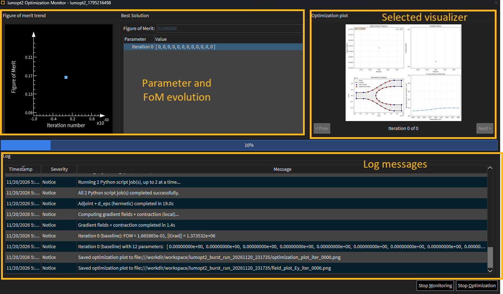

Running lumopt2 on Ansys Cloud Burst Compute™
==============================================

In addition to running locally and with a Slurm job scheduler, ``lumopt2`` can also leverage `Ansys Cloud Burst Compute™ <https://ansys.synopsys.com/products/cloud/ansys-cloud-burst-compute>`__ to run optimization tasks on the cloud.
With this capability, you can leverage the latest high-performance GPU/CPU hardware without having to set up your own cluster.

You must have an account and access to Ansys Cloud Burst Compute™ for ``lumopt2`` to run optimizations with this platform. For further information, see `Ansys Cloud Burst Compute™ for Lumerical FDTD <https://optics.ansys.com/hc/en-us/articles/39824576734867-Ansys-Cloud-Burst-Compute-for-Lumerical-FDTD>`__.

This guide explains how to set up and run ``lumopt2`` optimization using Ansys Cloud Burst Compute™. For detailed information on the Ansys Cloud Burst Compute™ platform and its latest capabilities, see the `Ansys Engineering Portal guide <https://ansyshelp.ansys.com/public/account/secured?returnURL=%2Fpublic%2FViews%2FSecured%2Fansportal%2Fv000%2Fen%2Fansportal_guide%2Findex.html>`__.

.. warning::

    Running on Ansys Cloud Burst Compute™ supports only the following parametrization types:

    - :py:class:`~lumopt2.parametrization.Parametrization`
    - :py:class:`~lumopt2.parametrization.ClosedCurve`

Setting up your optimization
----------------------------

When you run ``lumopt2`` on Ansys Cloud Burst Compute™, the script runs locally, but the :py:class:`~lumopt2.core.optimization.Optimization` object is uploaded and executed on the cloud.
For this reason, several restrictions apply to the optimization scripts. To successfully run an optimization using Ansys Cloud Burst Compute™, write your ``lumopt2`` script following these guidelines.

1. Only import from ``lumopt2``, ``numpy``, ``autograd``, ``scipy``, and ``math``. Imports from other modules are unsupported, even if they are unused for the cloud execution.
2. Have the :py:class:`~lumopt2.core.optimization.Optimization` object at the top level and write the script without ``Optimization.run()``. Runner settings are ignored.
3. Figure of merit definition must use a custom figure of merit function. To use a built-in figure of merit function, wrap it inside a custom function.

   .. code-block:: python

      port_out = PortResults('port_out1', metric='transmission',
                             wavelengths=wavelengths)

      def fct_pnorm(port_results: PortResults) -> float:
          """Compute the PNorm of the transmission to ``port_out1``."""
          return lumopt2.PNorm(p=2, target=0.5)(port_results) # Inside the FoM function, you must use `lumopt2` explicitly

      fom = lmpt.Fom(port_out, fct=fct_pnorm)

4. Functions needed during optimization must follow additional restrictions, as seen below.

For functions needed during the optimization, including the parametrization function, the figure of merit function, the configuration function, and a base simulation setup function in Python, the following additional restrictions apply:

1. The function must not be a lambda function.
2. The function must not rely on any external files, as only a ``.fsp`` or ``.lsf`` file passed into the :py:class:`~lumopt2.core.project.Project` in the ``setup`` field, or ``.lsf`` files passed through the project configuration, are uploaded during the submission.
3. For global variables to be accessible, they can only be of certain types: ``int``, ``float``, ``complex``, ``bool``, ``str``, and ``None``, as well as ``lists``, ``tuples``, ``dicts`` and NumPy arrays that contains strings, numbers, booleans, and ``None``. Other global variables are dropped and a warning is shown.
4. All auxiliary functions must be defined within the function scope.
5. Import statements or built-in functions that interact with the file system or execute code, such as ``open``, ``eval``, and ``exec``, are not allowed.

For a custom figure of merit function, the following additional restrictions apply:

1. The function must not contain references to **any** global variables.
2. The function can only use methods and classes from the following modules in addition to built-in types and methods: ``lumopt2``, ``np`` for ``numpy``, and ``anp`` for ``autograd.numpy``.

.. tip::

    To organize your optimization script when you have a long base simulation function and other variables, you can define it in another script and import them using ``from my_module import *`` to copy them to the main script at the top.

Submitting the optimization
---------------------------

To submit your optimization, use the :py:func:`~lumopt2.utils.burst_serdes.run_on_burst` function in a separate script, as this function runs the target optimization script.

.. code-block:: python

    from pathlib import Path
    import lumopt2

    # %%
    # Run lumopt2 with resource set to GPU
    script_path = Path(__file__).resolve().with_name("my_burst_simulation.py")
    lumopt2.run_on_burst(str(script_path), "GPU") # Defaults to GPU, use "CPU" to run with CPU

Additional settings can be passed using the ``burst_settings`` argument. See the Lumerical `run command <https://optics.ansys.com/hc/en-us/articles/360034931333-run-Script-command>`__ for further information on the applicable fields.

Monitoring and downloading results
----------------------------------

When you submit an optimization to Ansys Cloud Burst Compute™, an FDTD GUI opens and displays the progress of the simulation, including the current figure of merit, parameters, logs, and an optimization plot of your choice.

To select a visualizer to display, set the ``emit_base64`` attribute of the :py:class:`~lumopt2.utils.graphical_visualizer.GraphicalVisualizer` to ``True`` when creating it. Only a single visualizer can be emitted as a ``base64`` string for Burst. Multiple visualizers with ``emit_base64=True`` raise an error.

.. warning::

    Visualizers created from custom callback functions aren't supported.

.. code-block:: python

    visualizer = lmpt.GraphicalVisualizer(
        filename_prefix='field_plot_Ey',
        panels=[MonitorPanel(monitor_name='field_monitor',
                             result_name='E.Ey',
                             operation='real',
                             title='Ey field (real part)'),
        ],
        emit_base64=True  # emit image as base64 string for Burst
    )

To stop the optimization, you can either use the "Stop Optimization" button, or manually cancel it in the `Ansys Engineering Portal <https://portal.ansys.com>`__.
To stop monitoring the optimization, use the "Stop Monitoring" button.

.. note::

    Once you stop monitoring, you can only cancel the optimization manually in the `Ansys Engineering Portal <https://portal.ansys.com>`__.

Once the optimization completes or is stopped, the results are automatically downloaded to a ``lumopt2_burst_payload_XXXX`` folder next to the optimization script, containing both the optimization results and auxiliary files from the run on Ansys Cloud Burst Compute™.

.. warning::

    Results are not downloaded if you stop monitoring. You can download the results manually from the `Ansys Engineering Portal <https://portal.ansys.com>`__ in this case.

