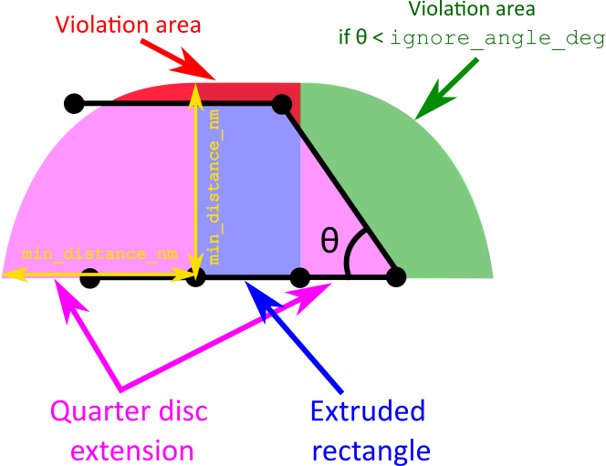

Constraints
===========

.. warning::

    You can only use constraints with the :py:class:`~lumopt2.parametrization.layout_shape.LayoutShape` parametrization.

Constraints in ``lumopt2`` offers capabilities to enforce design rules to the layout during optimization, to ensure that the layout remains manufacturable.

Each constraint by default applies to all layers loaded in the parametrization, but you can restrict it to each layer using the ``layer_name`` argument.

Constraint types
----------------

.. note::

    When using the :py:func:`~lumopt2.shape_optimization.optimize_shape` to set up shape optimization in a simplified way, you must use the :py:class:`~lumopt2.shape_optimization.DesignRules` class to define constraints instead of the classes below. However, the principles of the constraints remain the same.

Several types of constraints are available in ``lumopt2`` to enforce different design rules.

.. tip::

    If you need the design to strictly pass a design rule, add a ~1% margin to the threshold values set in ``lumopt2`` to account for any potential numerical rounding errors.

Minimum distance constraints
^^^^^^^^^^^^^^^^^^^^^^^^^^^^

The :py:class:`~lumopt2.constraints.manufacturing.MinDistanceConstraint` enforces a minimum distance between two edges. This effectively enforces minimum spacing or minimum width of materials.

To define a minimum spacing constraint, use ``outward`` for the ``direction`` argument.

.. code-block:: python

    min_distance = lmpt.MinDistanceConstraint(
        min_distance_nm=100.0,
        direction="outward",
    )

To define a minimum width constraint, use ``inward`` for the ``direction`` argument.

.. code-block:: python

    min_distance = lmpt.MinDistanceConstraint(
        min_distance_nm=100.0,
        direction="inward",
    )

The minimum distance constraint checks for width or spacing via an extruded rectangle from a given edge, plus an additional quarter disc on either side of the rectangle, as seen in the diagram below.

In the quarter disc extension region, all angles at or above the ``ignore_angle_deg`` argument are ignored for the check. The default value is 90 degrees, which ignores all square facets.

.. code-block:: python

    min_distance = lmpt.MinDistanceConstraint(
        min_distance_nm=100.0,
        direction="outward",
        ignore_angle_deg=45, # Ignore angles above 45 degrees in the quarter disc check region
    )

In :py:class:`~lumopt2.utils.panels.ManufacturingMetricsPanel`, the value reported for the minimum distance constraint is the overlap area between the test polygon and neighbouring edges, which quantifies the extent of the violation.

Minimum angle constraint
^^^^^^^^^^^^^^^^^^^^^^^^

The minimum angle constraint checks all angles in the layout, and you can set the minimum allowed angle using the ``min_angle_deg`` argument.

.. code-block:: python

    min_angle = lmpt.MinAngleConstraint(min_angle_deg=80.0)

Minimum area constraint
^^^^^^^^^^^^^^^^^^^^^^^

The minimum area constraint checks the area of all polygons in the layout, and you can set the minimum allowed area using the ``min_area_um2`` argument.

.. code-block:: python

    min_area = lmpt.MinAreaConstraint(min_area_um2=0.01)

Minimum edge length constraint
^^^^^^^^^^^^^^^^^^^^^^^^^^^^^^

The minimum edge length constraint is an auxiliary check that helps to avoid extremely short edges that does not contribute to the optical performance, but trips the design rule checks in ``lumopt2``

Generally, set the minimum edge length to a few GDS grid units. For example, you can set the length to 5 nm for a 1 nm grid.

.. note::

    In the simplified setup approach using :py:func:`~lumopt2.shape_optimization.optimize_shape`, this constraint is automatically applied.

.. code-block:: python

    min_edge = lmpt.MinEdgeLengthConstraint(min_edge_nm=5.0)

Using constraints
-----------------

To use constraints in your optimization, first define the constraints, and then pass them as a list to the ``constraints`` argument of the optimization session, with the ``restore_constraint`` flag set to ``True``.

.. code-block:: python

    constraints = [min_angle, min_distance, min_edge] # Define each constraint in the list using the classes above
    optimization = lmpt.Optimization(
        project=project,
        optimizer=optimizer,
        constraints=constraints,
        restore_constraints=True,
    )

You can also visualize and log constraints using :py:class:`~lumopt2.utils.callbacks.ConstraintLogger` and :py:class:`~lumopt2.utils.panels.ManufacturingMetricsPanel`.