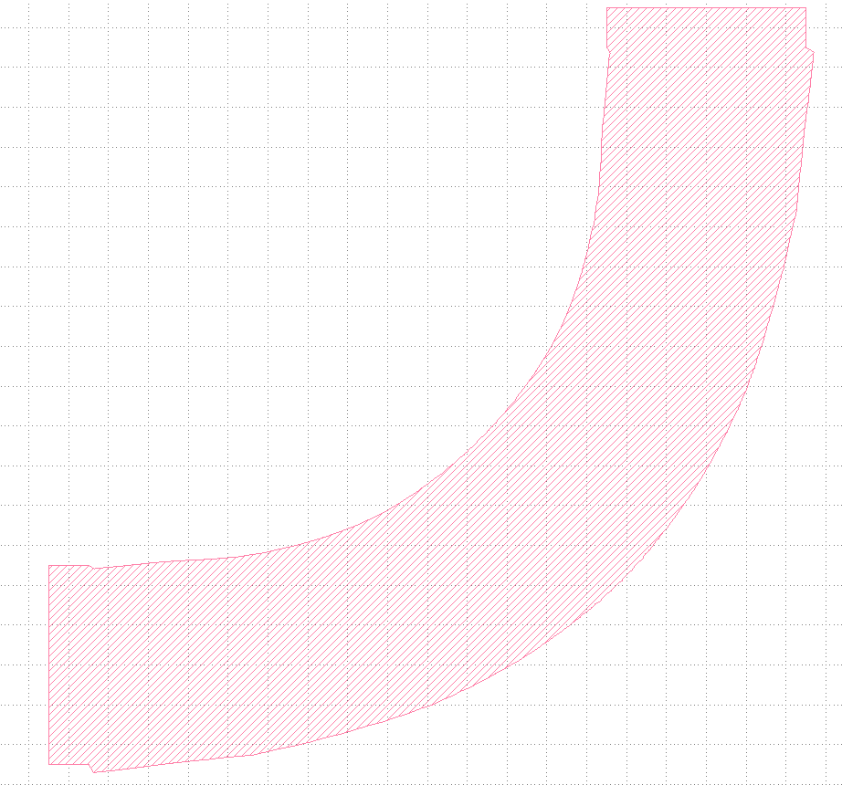
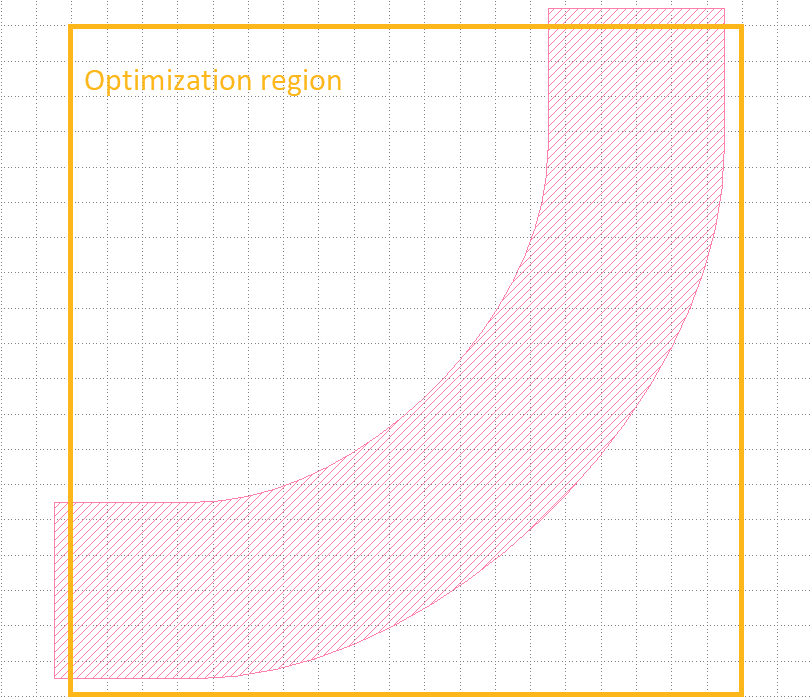
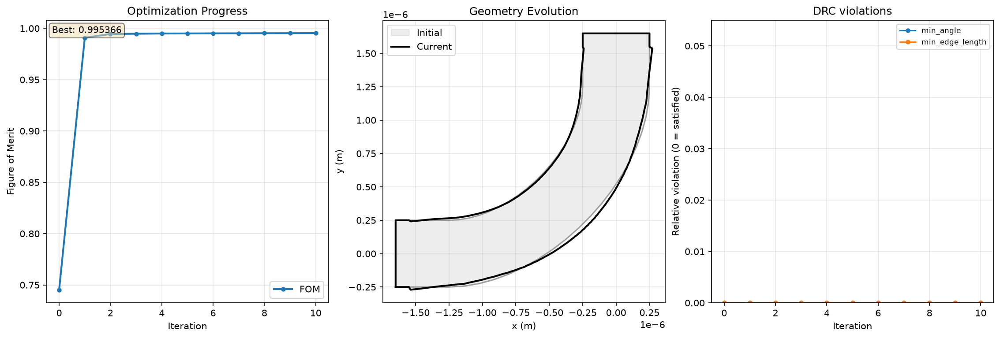

.. grid:: 2 2 2 2

    .. grid-item::

        .. button-link:: ../../_static/simulation_examples/lumopt2_lbend_shape/l_bend_shape_opt.py
            :color: secondary
            :shadow:
            :align: center

            :octicon:`download` Download Python Script (.py)

    .. grid-item::

        .. button-link:: ../../_static/simulation_examples/lumopt2_lbend_shape/l_bend_gds_and_process.zip
            :color: secondary
            :shadow:
            :align: center

            :octicon:`download` Download package (.zip)

Getting started with lumopt2: L-bend shape optimization
=======================================================

The ``lumopt2`` module offers layout-driven shape optimization capabilities for photonic devices, where a device layout is directly inputted and
the shape is directly optimized in accordance with the design rules that are already set.

This example demonstrates a simple use case of shape optimization using an L-bend waveguide coupler.

For a basic example demonstrating ``lumopt2`` workflow, see the :doc:`simple metalens example <getting_started_simple_metalens>`.
For an L-bend example that uses the closed curve parametrization approach, see the :doc:`parametric L-bend example <getting_started_l_bend>`.

The Python script and layout files associated with this example is attached to the article.

To run this example, download the script and the associated files from the links above. Place the contents of the package in the same directory as the script.

Base simulation
---------------

The setup of the base simulation for shape optimization is very similar to other types of optimizations, which is seen in the :doc:`L-bend <getting_started_l_bend>` and :doc:`3x3 metalens <getting_started_simple_metalens>` examples.
The only unique setup procedure for shape optimization is that you must set up a layer builder object, and load the corresponding layout GDS file and the process file defining layer thicknesses.

.. literalinclude:: ../../_static/simulation_examples/lumopt2_lbend_shape/l_bend_shape_opt.py
    :language: python
    :start-at: fdtd.addlayerbuilder
    :end-at: fdtd.loadprocessfile
    :dedent: 4
    :lineno-match:

To use shape optimization, you must also center the layer object at the origin.

.. literalinclude:: ../../_static/simulation_examples/lumopt2_lbend_shape/l_bend_shape_opt.py
    :language: python
    :start-at: "gds position reference"
    :end-at: fdtd.setnamed("layer group", "y", 0)
    :dedent: 4
    :lineno-match:

.. warning::

    Layout-driven shape optimization also does not support sidewall angles, rotation, and Boolean operations in the layer builder object.

Optimization region
-------------------

The optimization region is set up to only cover a portion of the device in this case, leaving a short stub on each side for connection with the input and output waveguides.

.. literalinclude:: ../../_static/simulation_examples/lumopt2_lbend_shape/l_bend_shape_opt.py
    :language: python
    :start-at: stub_length =
    :end-at: )
    :lineno-match:

Figure of merit
---------------

This example showcases the use of the shortcut function for layout-driven shape optimization to simplify the setup process, which uses many default settings.

In this case, the figure of merit is the transmission through the L-bend. Here, it is built using the short-hand :class:`~lumopt2.shape_optimization.Transmission` function, which automatically
creates a :class:`~lumopt2.fom.simulation_results.PortResults` using the wavelength range set in the port and default values for the FoM function. You can also manually define the figure of merit, as
done in the :doc:`parametric L-bend <getting_started_l_bend>` example.

.. literalinclude:: ../../_static/simulation_examples/lumopt2_lbend_shape/l_bend_shape_opt.py
    :language: python
    :start-at: fom = lmpt.Transmission
    :end-at: fom = lmpt.Transmission
    :lineno-match:

.. note::

    The :class:`~lumopt2.shape_optimization.Transmission` class is only used for the shortcut function, and is not used if you define the project manually.

Design rules
------------

To ensure the output device adheres to design rules, you can define them using the :class:`~lumopt2.shape_optimization.DesignRules` class. In this example, the only rule set is a minimum angle of 90 degrees.

.. literalinclude:: ../../_static/simulation_examples/lumopt2_lbend_shape/l_bend_shape_opt.py
    :language: python
    :start-at: rules = lmpt.DesignRules
    :end-at: rules = lmpt.DesignRules
    :lineno-match:

Run the optimization
--------------------

To run shape optimization, use the :func:`~lumopt2.shape_optimization.optimize_shape` function. This is a shortcut function that uses many default options and simplifies the setup.
To use this function, you must pass required arguments such as the GDS path, setup function, FoM, and layer name to optimize.
This example also passes in the desired design rules and a maximum of 10 iterations.

From here, this function automatically sets up the rest of the optimization, such as the project and optimization session, runs the optimization, and outputs the final GDS file.

.. literalinclude:: ../../_static/simulation_examples/lumopt2_lbend_shape/l_bend_shape_opt.py
    :language: python
    :start-at: result = lmpt.optimize_shape(
    :lineno-match:

.. tip::

    You can also normally set up the optimization by manually defining the figure of merit, design rules, parametrization, and object. See the :doc:`user guide <../photonic_inverse_design_with_lumopt2>` for further information.

During the run, you can see updates of the figure of merit, geometry, and design rule compliance. The design rule violation panel shows zero if there are no violations.

After the optimization completes, a GDS file is outputted with other optimization results.

Further resources
-----------------

After completing this example, further explore lumopt2 using the following pages.

.. grid:: 2 2 3 3

    .. grid-item-card:: lumopt2 user guide
        :link: ../photonic_inverse_design_with_lumopt2
        :link-type: doc

        Reference for key concepts in lumopt2 in further detail.

    .. grid-item-card:: lumopt2 API reference
        :link: ../../api/lumopt2/index
        :link-type: doc

        Full API reference for lumopt2, including all available classes and functions.

.. grid:: 2 2 2 2

    .. grid-item::

        .. button-link:: ../../_static/simulation_examples/lumopt2_lbend_shape/l_bend_shape_opt.py
            :color: secondary
            :shadow:
            :align: center

            :octicon:`download` Download Python Script (.py)

    .. grid-item::

        .. button-link:: ../../_static/simulation_examples/lumopt2_lbend_shape/l_bend_gds_and_process.zip
            :color: secondary
            :shadow:
            :align: center

            :octicon:`download` Download package (.zip)
