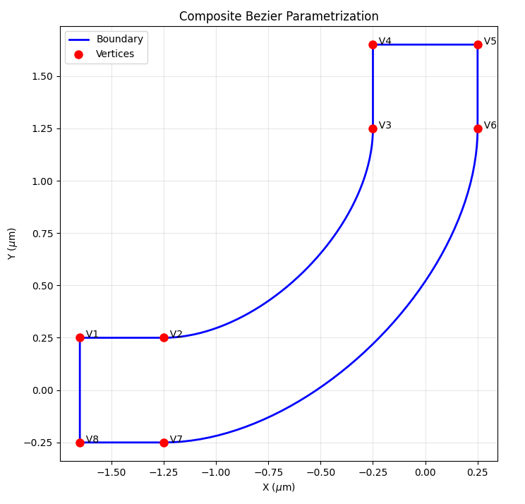
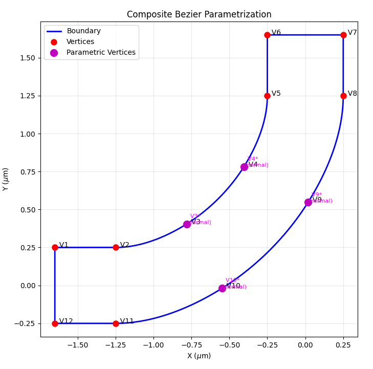
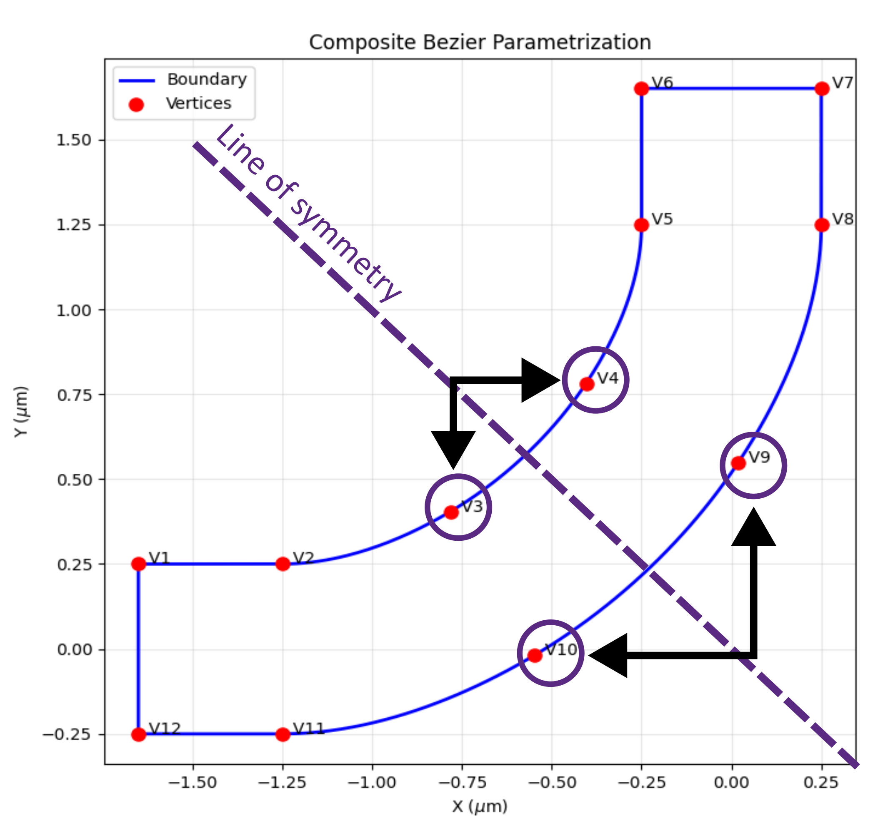

Parametrization
===============

Parametrization is the process of linking properties and geometry of the simulation to the optimization.

The lumopt2 module supports several types of parametrization:

- **Parametric optimization**: optimizes the design by directly assigning parameters of a device. There are two approaches within this category:

  - **Parametrization object**: maps optimization parameters to arbitrary Lumerical object properties.
  - **Closed curve object**: maps optimization parameters to a special class that defines a closed polygon.

- **Shape optimization**: optimizes the design by directly working with the geometry of the device.

Regardless of the parametrization type, you must first define the optimization region. Within this region, the parameters are adjusted.

Optimization region
--------------------

The optimization region defines the bounds within which the geometry of the simulations is varied during optimization. You must ensure that all permutations of the geometry variation stays within the optimization region you define.

To define an optimization region, use the :py:class:`~lumopt2.utils.common.Box` class, which takes either the center and span, or min and max values in each dimension.
In the definition, you can additionally specify the grid resolution in each dimension using the ``dx, dy, dz`` arguments.
If you do not specify the grid resolution, the optimization region is set up with a default resolution determined by the `mesh override simulation object <https://optics.ansys.com/hc/en-us/articles/360034901833-Mesh-override-Simulation-Object>`__.

.. code:: python

   # Define an optimization region centered at the origin with a span of 1 micron in each
   # direction and a mesh size of 25 nm
   optimization_region = lmpt.Box(x_span = 1e-6, y_span = 1e-6, z_min = -1e-6, z_max = 1e-6,
                                 dx = 0.025e-6, dy = 0.025e-6, dz = 0.025e-6)

Parametric optimization
------------------------

You can conduct parametric optimization using either the general-purpose :py:class:`~lumopt2.parametrization.parametrization.Parametrization`, or the specialized :py:class:`~lumopt2.parametrization.closed_curve.ClosedCurve` class, which is designed for photonic integrated circuit applications.

Parametrization class
~~~~~~~~~~~~~~~~~~~~~

The :py:class:`~lumopt2.parametrization.parametrization.Parametrization` class maps optimization parameters to arbitrary Lumerical object properties.
This approach is the most general way to parametrize a design in lumopt2, and is suitable for a wide range of applications.

For a simple example of setting parametric optimization, see the :doc:`3x3 pillar example in the getting started section <getting_started_simple_metalens>`.

Defining parameter mapping
^^^^^^^^^^^^^^^^^^^^^^^^^^

To use the parametric optimization approach, you must define a function that takes a parameter vector as input, and outputs a dictionary where the keys are the names of Lumerical object properties, and the values are elements in the parameter vector.

For example, to define a parametrization that links the radius of different cylinders in the simulation, use the following code.

.. code:: python

   def my_parametrization(params):
      '''Map 3 parameters to cylinder radii'''
      return {
         "cyl0::radius": params[0],
         "cyl1::radius": params[1],
         "cyl2::radius": params[2]
      }

This effectively defines:

- :math:`p_0`: radius of cylinder 0
- :math:`p_1`: radius of cylinder 1
- :math:`p_2`: radius of cylinder 2

Here, the Lumerical object properties are specified in the format ``object_name::property_name``, or the more general ``group_name::object_name::property_name``.
Typically, you can find the property using the GUI, or by using the `getnamed <https://optics.ansys.com/hc/en-us/articles/360034408574-getnamed-Script-command>`_ command either through Lumerical scripting or Python by calling ``fdtd.getnamed("my_object_name")``.

You can also define more complex parameter mapping, as any differentiable function of the parameter vector is supported.
For example, define a parametrization such that :math:`p_1` is the difference between the radius of cylinder 1 and cylinder 0, and :math:`p_2` is the difference between the radius of cylinder 2 and cylinder 1.

.. code:: python

   def my_parametrization(params):
      '''Map 3 parameters to cylinder radii'''
      return {
         "cyl0::radius": params[0],
         "cyl1::radius": params[0] + params[1],
         "cyl2::radius": params[0] + params[1] + params[2]
      }

You can also map parameters to a vector property of an object, such as the vertices of a polygon object. The autograd numpy library is used here to ensure that autograd can compute the Jacobian of the parameter mapping function.

.. code:: python

   def polygon_parametrization(params):
      return {
         f"poly{idx}::vertices": anp.array([[0, value], [value, 0],
                                             [0, -value], [-value, 0]])
         for idx, value in enumerate(params)}

      }

Bounds and initial values
^^^^^^^^^^^^^^^^^^^^^^^^^

The parameter mapping function and the optimization region is passed along with the bounds for each parameter and an optional vector of initial values to the :py:class:`~lumopt2.parametrization.parametrization.Parametrization` class.

The bounds are passed as a list of tuples with the same length of the parameter vector, each element containing the lower and upper bound for each parameter. The initial values are passed as a list of values with the same length of the parameter vector.

The following example illustrates the definition of bounds and initial values for the 3-cylinder example above.

.. note::

   If the initial values are not provided, the optimization starts from the middle of the bounds by default.

.. code:: python

   parametrization = lmpt.Parametrization(
      func=mixed_parametrization,
      bounds=[(50e-9, 200e-9)] * 3,
      initial_params=[100e-9] * 3
   )

Functions not differentiable by autograd
^^^^^^^^^^^^^^^^^^^^^^^^^^^^^^^^^^^^^^^^

You can also define parameter mapping functions that autograd cannot track. In this case, you can set the ``use_jac`` property of the :py:class:`~lumopt2.parametrization.parametrization.Parametrization` object to False.
In this case, the class assumes that each optimization parameter affects all geometic objects in the optimization region, which may lead to less efficient gradient calculations.

.. code:: python

   def nondiff_func_parametrization(params):
      '''Map 5 parameters to cylinder radii using non-differentiable functions'''
      return {
         "cyl0::radius": nondiff_func1(params),
         "cyl1::radius": nondiff_func2(params),
         "cyl2::radius": nondiff_func3(params)
      }

   parametrization = lmpt.Parametrization(
      func=nondiff_func_parametrization,
      bounds=[(50e-9, 200e-9)] * 5,
      initial_params=[200e-9] * 5,
      use_jac=False
   )

Closed curve class
~~~~~~~~~~~~~~~~~~

The :py:class:`~lumopt2.parametrization.closed_curve.ClosedCurve` class defines a special type of parametric optimization that defines a closed Bézier polygon using a series of paths, each of which can be linear or cubic.
This approach is generally useful for photonic integrated circuit applications, where the design is readily transformed into a polygon on a 2-D plane. As seen in the sections below, you can also enforce symmetry in the design by linking control points to each other.

Closed curve base object
^^^^^^^^^^^^^^^^^^^^^^^^

To set up a closed curve optimization, you must first define the base geometry object using :py:class:`~lumopt2.parametrization.closed_curve.ClosedCurve`.

The :py:class:`~lumopt2.parametrization.closed_curve.ClosedCurve` class ingests a list of control points, index, and thickness information to define a waveguide-like structure.
When you set up the base geometry object, specify only the control points necessary for the geometry. Additional control points for optimization are added later in the process.

To specify the control point, use a list of :py:class:`~lumopt2.parametrization.closed_curve.Segment`. Each element in the list corresponds to a control point in the curve, and definitions within the :py:class:`~lumopt2.parametrization.closed_curve.Segment` element specifies the location of the segment and how it connects to the next segment.

For example, the following code defines a simple L-bend within an FDTD simulation region, with a width of 500nm and bend radius of 1 micron.

.. code:: python

   bend_radius     = 1.0e-6
   bend_start      = wg_width/2+bend_radius
   dist_to_wall    = 0.4e-6                        # Distance from wall to start of the bend (lead waveguides)
   fdtd_min_x      =-(bend_start + dist_to_wall)
   fdtd_max_x      = 2*wg_width

   fdtd_min_y      =-2*wg_width
   fdtd_max_y      = bend_start + dist_to_wall

   path = [ Segment([ fdtd_min_x,              wg_width/2],             'linear'),  # Segment 1 - linear
         Segment([-wg_width/2-bend_radius,  wg_width/2],             'cubic'),   # Segment 2 - cubic
         Segment([-wg_width/2,              wg_width/2+bend_radius], 'linear'),  # Segment 3 - linear
         Segment([-wg_width/2,              fdtd_max_y],             'linear'),  # Segment 4 - linear
         Segment([ wg_width/2,              fdtd_max_y],             'linear'),  # Segment 5 - linear
         Segment([ wg_width/2,              wg_width/2+bend_radius], 'cubic'),   # Segment 6 - linear
         Segment([-wg_width/2-bend_radius, -wg_width/2],             'linear'),  # Segment 7 - linear
         Segment([ fdtd_min_x,             -wg_width/2],             'linear'),  # Segment 8 - cubic
       ]

After defining the segments, set up the closed curve object by passing in the list of segments along with the optimization region, the waveguide index and the thickness of the waveguide.

.. code:: python

   n_wg = 3.5 # Silicon waveguide
   wg_height = 0.22e-6 # 220nm height

   closed_curve = lmpt.ClosedCurve(path, optimization_region=optimization_region, index=n_wg, z_min=-wg_height/2.0, z_max= wg_height/2.0)

You can visualize the defined curve using :py:class:`ClosedCurve.plot() <lumopt2.parametrization.closed_curve.ClosedCurve>` function.

.. code:: python

   closed_curve.plot()

Parametrize closed curves
^^^^^^^^^^^^^^^^^^^^^^^^^

To parametrize the closed curve, you can use the :py:class:`~lumopt2.parametrization.closed_curve.Parametrize` class, which adds additional control points along a segment so they can vary during optimization.
You specify the start index of a segment based on the path you defined earlier for the base curve, the number of control points, the bounds to apply to all new control points, and the degree of freedom for the new control points.

.. note::

   The vertex index for the closed curve is 1-based.

After defining the parametrization, finalize the parametrization using :py:class:`ClosedCurve.make_segments_parametric() <lumopt2.parametrization.closed_curve.ClosedCurve>`.

.. code:: python

   num_pts_per_curve = 2
   bounds = (-200e-9, 400e-9)
   segments_to_parametrize = [lmpt.Parametrize(segment_index=2, num_added_vertices=num_pts_per_curve, bounds=bounds, movement='normal'),  # Outer sidewall
                              lmpt.Parametrize(segment_index=6, num_added_vertices=num_pts_per_curve, bounds=bounds, movement='normal')]  # Inner sidewall
   closed_curve.make_segments_parametric(segments_to_parametrize)

.. note::

   In the example above, the ``movement`` argument is set to "normal," allowing the new control points to move normal to the curve. You can also set it to "x," "y," or "both" to specify the degree of freedom for the control points.

After defining the parametrized segments, you can also visualize the curve with the new control points using :py:class:`ClosedCurve.plot() <lumopt2.parametrization.closed_curve.ClosedCurve>` function.

.. code:: python

   closed_curve.plot()

As seen in the visualization above, new vertices are added to the curve, and the original vertices numbers are shifted to account for the new vertices. The variable vertices are vertices V3, V4, V9, and V10.

Symmetric parametrization
^^^^^^^^^^^^^^^^^^^^^^^^^

Sometimes, it is desirable to enforce symmetry in the design, such that certain control points move in relation to each other during optimization.

In this case, you must define a custom parametrization function that maps vertices to the same parameters using :py:class:`ClosedCurve.set_parametrization_function() <lumopt2.parametrization.closed_curve.ClosedCurve>`.

The custom parametrization function must directly act on a parameter array and link vertex numbers to the parameters, and return how each vertex of interest should move.
To achieve this, you can first manually split the segment into a desired number of control points using :py:class:`lumopt2.parametrization.closed_curve.EqualSplit`, and create vertex parameters using :py:class:`lumopt2.parametrization.closed_curve.ParamVertex`.

For example, the following code defines a custom parametrization function that enforces symmetry for the control points on the L-bend example above for a :math:`y=-x` symmetry, by effectively mapping the movement of specific control points to the same parameters.

.. code:: python

   num_pts_per_curve = 2                                  # Control vertices per curved segment
   num_free_per_curve = (num_pts_per_curve + 1) // 2      # Symmetry halves the DOF (rounded up so an odd middle vertex still counts once)
   num_params         = 2 * num_free_per_curve            # Two segments x free DOF per segment

   # Subdivide the segments

   split_result = closed_curve.split_segments([
   lmpt.EqualSplit(segment_index=2, num_added_vertices=num_pts_per_curve),  # Outer sidewall
   lmpt.EqualSplit(segment_index=6, num_added_vertices=num_pts_per_curve),  # Inner sidewall
   ])

   vertices_seg2 = split_result[2]
   vertices_seg6 = split_result[6]

   # Define custom parametrization function

   def symmetric_parametrization(params):
      return [ lmpt.ParamVertex(idx=3, value=params[0], movement='normal'),
               lmpt.ParamVertex(idx=4, value=-params[0], movement='normal'),
               lmpt.ParamVertex(idx=9, value=params[1], movement='normal'),
               lmpt.ParamVertex(idx=10, value=-params[1], movement='normal'),
            ]

      # Define bounds and set custom parametrization function

   bounds = (-200e-9, 400e-9)
   closed_curve.set_parametrization_function(
      func=symmetric_parametrization,
      n_params=num_params,
      bounds=bounds,
   )

The diagram below shows how the control points maps to each other in terms of movement.

Shape optimization
------------------

Shape optimization in ``lumopt2`` directly optimizes an input layout geometry, rather than relying on a parametric representation of the device.
This optimization method directly moves vertices of the layout geometry, adhering to set design rules to ensure manufacturability.

There are two ways of setting up shape optimization, depending on the degree of control you want over optimization settings.
The full setup method provides all the available settings, and a simplified setup function sets up the optimization with many settings set to default values.

Full setup
~~~~~~~~~~

The full setup procedure uses the :py:class:`~lumopt2.parametrization.layout_shape.LayoutShape` parametrization class.

.. code-block:: python

   shape = lmpt.LayoutShape(
      layer_name=LAYER_NAME,
      optimization_region=optimization_region,
      bounds=(-300e-9, 300e-9),
      vertex_freedom="cartesian",
      resample_edge_length=30e-9,  # coarse: suppress sub-grid notches at split tip
   )

This class defines the layer to optimize, along with how the vertices move including direction via ``vertex_freedom`` and the bounds for this movement. Design rules are included as constraints to the optimization session.

By default, all vertices strictly within the optimization region is movable.
However, you can further specify which vertices to move via ``movable_region``, which uses a box to define movable vertices, or ``movable_winding`` which allows you to select holes within a structure.

Since shape optimization directly manipulates the vertices, the sampling of the input geometry affects optimization results. Therefore, an option to explicitly apply a target resampling length is available via ``resample_edge_length``.
Typically, adjusting this value to around a single FDTD mesh spacing helps to avoid small edge artifacts that are hard to manufacture, while maintaining enough freedom for the device to effectively optimize.

To account for symmetrical structures, the :py:class:`~lumopt2.parametrization.layout_shape.LayoutShape` class by default automatically detects `symmetrical boundary conditions <https://optics.ansys.com/hc/en-us/articles/360034382694-Symmetric-and-anti-symmetric-BCs-in-FDTD-and-MODE>`__ set in FDTD, and ensures that both sides of the symmetry plane are updated consistently.
In the case where you wish to set your own symmetry that is separate from FDTD boundary conditions, you can do so using the ``mirror_plane`` argument.

In the full setup procedure, the parametrization object here is passed into the project in the same way as parametric optimizations. For further information on how to use constraints, see the :doc:`constraints <constraints>` page.
The constraints are then defined and applied as a part of the optimization session, and the optimization proceeds in the usual manner.

.. note::

   Shape optimization currently only supports the :py:class:`~lumopt2.optimizer.gradient_ascent.GradientAscentOptimizer` optimizer.

Simplified setup
~~~~~~~~~~~~~~~~~

To set up shape optimization with a simplified procedure, you can use the :py:func:`~lumopt2.shape_optimization.optimize_shape` wrapper function.

Compared to the full setup procedure, this function supports specialized shorthand objects for defining the constraints and figure of merit, and chooses many simulation defaults which should simplify the overall procedure.

For the figure of merit, you can use the simplified class :py:class:`~lumopt2.shape_optimization.Transmission` when using this wrapper function. This class allows you to create a transmission figure of merit by only specifying the port name.

.. code-block:: python

   fom = lmpt.Transmission("port_out")

.. tip::

   If you wish to customize the figure of merit, :py:func:`~lumopt2.shape_optimization.optimize_shape` also accepts a fully defined figure of merit object from :py:func:`~lumopt2.fom.fom.Fom`.

For constraints, use the simplified class :py:class:`~lumopt2.shape_optimization.DesignRules` to specify a set of rules for the optimization.

.. code-block:: python

   rules = lmpt.DesignRules(min_space=100e-9, min_angle=80, angle_limit=85)

.. warning::

   The simplified setup only supports the use of the simplified design rule class. You cannot use a fully defined design rule object such as :py:class:`~lumopt2.constraints.manufacturing.MinDistanceConstraint`.

Finally, you can also directly define the number of iterations for the optimization and the output GDS file within the simplified setup, using the ``max_iterations`` and ``output_gds`` arguments.
A set of default visualizers are provided, but you can also specify your own using the ``callbacks`` argument.
The resampling length is also automatically picked to be half of the smallest FDTD mesh spacing, but you can override this by specifying the ``vertex_spacing`` argument.

.. code-block:: python

   result = lmpt.optimize_shape(
      gds=gds_path,
      setup=generate_base_sim,
      layer=layer_name,
      region=optimization_region,
      fom=y_branch_fom,
      rules=rules,
      output_gds=output_gds,
      max_iterations=10,
   )

Combined parametrization
-------------------------

If you have multiple parametrizations with the same optimization region, you can combine them into a single joint parametrization object using :py:class:`~lumopt2.parametrization.combined_parametrization.CombinedParametrization`, which takes in a list of parametrization objects.
In this case, the parameter vectors are automatically concatenated between the different inputs.